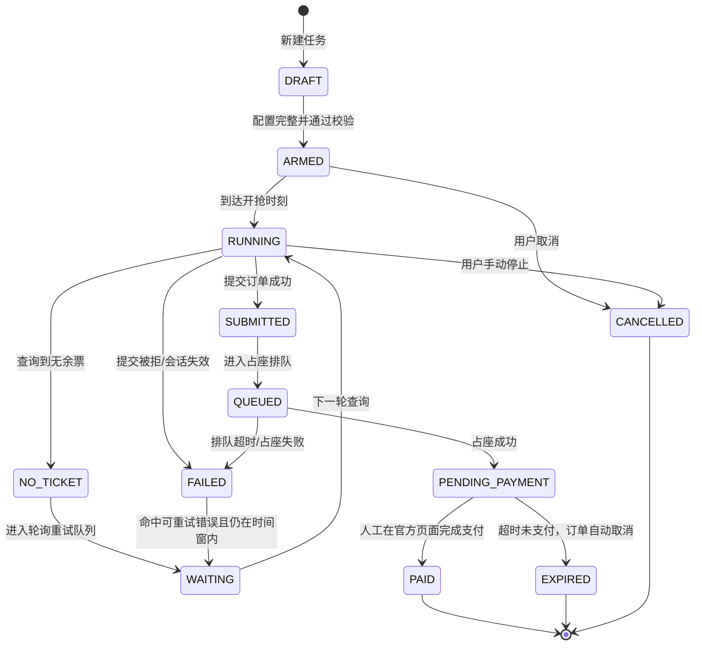
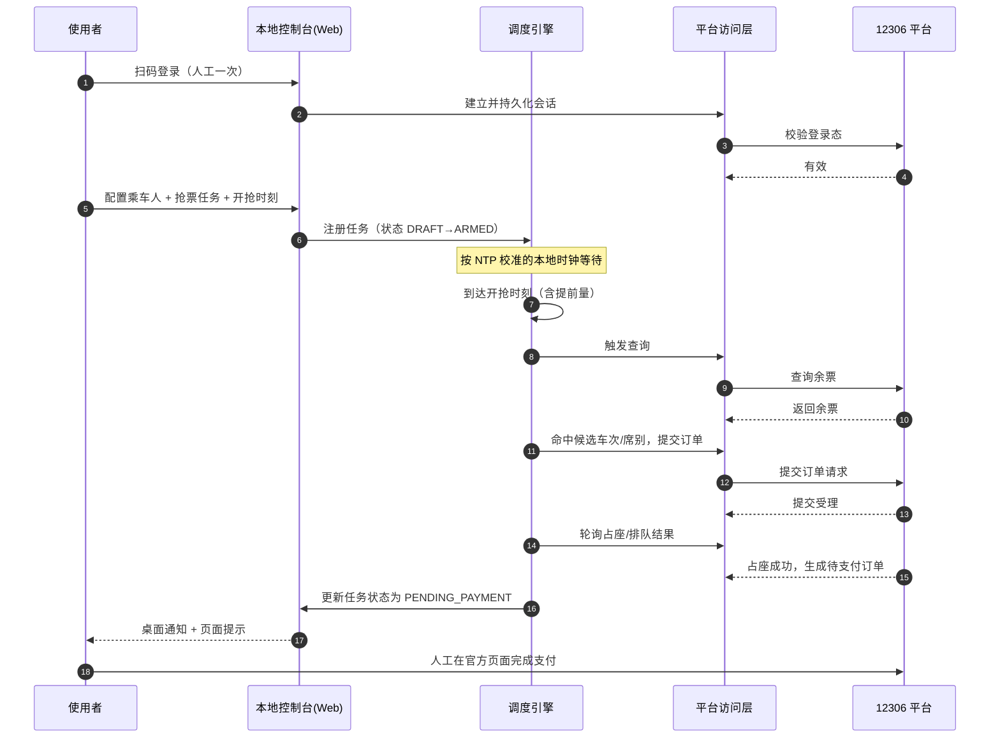
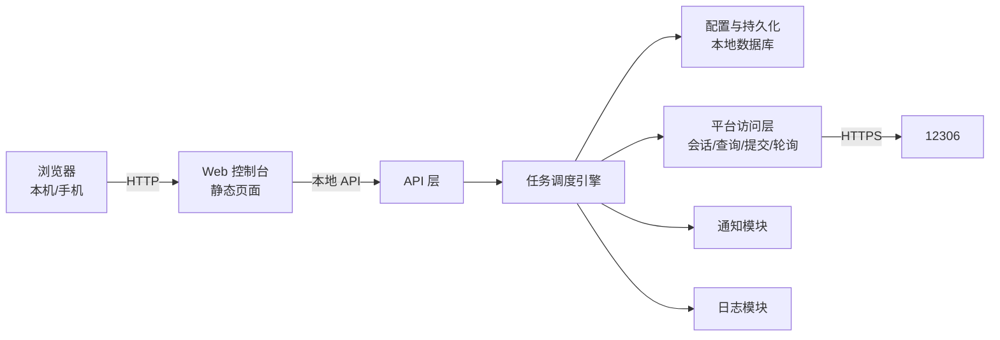

# 12306 自动购票助手 · 产品需求与技术实现方案

| 项目 | 内容 |
|---|---|
| 文档类型 | 功能需求 + 技术路线（合并版） |
| 目标平台 | Windows 本机运行，本地 Web 服务形态 |
| 使用范围 | 仅本人及直系亲属自用，不收费、不对外提供服务 |
| 版本 | v0.3（取消微信推送，通知改为桌面通知） |
| 日期 | 2026-10-16 |

> 阅读提示：本文把「产品需求」和「技术路线」写在同一份文档里，第 1–6 章回答**做什么、什么条件下做什么**，第 7 章回答**怎么实现**，第 8 章是必须先看的合规与风险，第 9 章记录已确认的决策与遗留事项。

---

## 1. 背景与目标

### 1.1 问题
12306 的票按车站分批起售（多数车站在 08:00–18:00 之间的整点或半点放票），热门车次的余票窗口通常只有几秒到几十秒。人工操作需要在极短时间内完成「查询 → 选中车次与席别 → 勾选乘车人 → 提交订单」，手速和网络往返往往撑不住；同时乘车人身份证号需要每次都准确勾选，人工容易漏选或选错。

### 1.2 产品决策
做一个**只在本机运行的本地 Web 应用**，把「在起售时刻手忙脚乱地点票」变成「提前配好一条抢票任务，到点由程序自动完成查询与提交」。用户只做三件事：登录一次、配好任务、看结果。

### 1.3 期望的可观察结果
- 到达设定时刻后，任务**无需人工干预**即可开始查询并提交订单；
- 任务结果在控制台上以明确状态呈现：`已提交 / 排队中 / 占座成功待支付 / 无票 / 失败及原因`；
- 乘车人按身份证号精确命中，不出现错选、漏选；
- 全程留有可追溯的操作日志。
- **不承诺**：一定买到票。本工具只提升提交成功率与速度，不改变余票本身的供需。

---

## 2. 范围

### 2.1 P0 —— 最小完整闭环（必须做）
1. 登录态获取：本机扫码登录一次，会话持久化；
2. 乘车人档案维护（姓名 + 身份证号）；
3. 创建抢票任务：出发站、到达站、乘车日期、候选车次（有序）、席别优先级、乘车人、**开抢时刻**；
4. 到点自动开抢：定时触发 → 查询 → 提交订单；
5. 结果反馈：Web 控制台状态 + 桌面通知（本机弹窗，不经任何外部通道）；
6. 恢复路径：无票时按候选车次序列继续尝试，提交失败时按策略重试（见 6.3、6.4）。
7. 一键跳转支付：**支付必须由人工在官方页面完成**。

### 2.2 P1 —— 提升成功率与体验
- 多任务并行与任务队列；
- 备用通知通道（邮件），桌面通知为主通道；
- 历史任务与订单记录、导出。

### 2.3 明确不做（防止范围蔓延）
| 不做的事 | 原因 |
|---|---|
| 自动支付 / 自动扣款 | 涉及资金与免密，风险不可接受，且官方流程本身要求人工确认 |
| 验证码自动识别与绕过 | 属于规避平台安全机制，不做设计与实现，改为人机协同（见 7.3） |
| 多账号账号池、IP 代理池、并发压测式刷票 | 违反平台条款且极易触发风控封号 |
| 对外提供服务、代抢收费、帮陌生人代买 | 存在明确法律风险，见第 8 章 |
| 安卓/iOS 移动端原生 App | 本地 Web 控制台已可用手机浏览器访问，不必另做原生端 |
| 席别自动降级（如二等座无票自动改一等座） | 已确认不降级，避免买到预期之外的席别；无票即继续按候选车次与下一轮重试 |
| 官方候补自动下单 | 已确认不使用候补，无票场景只按候选车次序列重试至时间窗结束 |

---

## 3. 角色与关键对象

### 3.1 角色
- **使用者（本人）**：本机唯一的登录者与配置者，也是支付环节的唯一执行人。
- **乘车人**：被下单的主体，其身份证号是下单时的关键标识。
- **12306 平台**：车票数据的权威来源，同时是风控与条款的约束方。

### 3.2 关键对象与状态机

**抢票任务（Task）是本系统的核心对象**，一切配置与运行结果都挂在它上面。

> 状态由程序写入并展示，**只有 `PAID` 由人工支付动作触发**。任何状态下都不允许程序自行完成支付。

**其他对象**

| 对象 | 说明 | 关键字段 |
|---|---|---|
| 登录会话 Session | 一次扫码登录后的凭证与有效期 | 状态（有效/失效）、最近校验时间 |
| 乘车人档案 | 可复用的出行人 | 姓名、证件类型、证件号、是否默认 |
| 席位偏好 SeatPreference | 允许的席别与优先级 | 席别序列、是否接受无座 |
| 订单 Order | 平台侧产生的订单 | 订单号、车次、席别、金额、状态 |
| 通知记录 | 每次推送的事实 | 通道、时机、结果 |

---

## 4. 核心流程

### 4.1 端到端时序（P0）

### 4.2 关键节点说明
- **开抢时刻**：由用户**手填**（精确到秒），系统不内置车站起售时间表；创建任务时需自行查证目标车站的起售时间。
- **提前量**：在目标时刻**之前**发出第一轮查询请求，具体提前量见 6.1。
- **提交顺序**：查询到余票 → 校验乘车人已选中 → 提交 → 轮询结果。三者串行，不做并发提交（见 6.2）。

---

## 5. 功能需求

功能模块按 Structure A（按任务/模块）组织，每个模块覆盖：目的 → 触发 → 处理规则 → 结果与状态变化 → 例外。

### FR-01 登录与会话管理
- **目的**：让程序具备查询与下单的合法身份。
- **触发**：用户在控制台点击「登录」。
- **处理规则**：
  1. 默认采用**扫码登录**：控制台展示二维码，用户用 12306 官方 App 扫码确认；
  2. 登录成功后，会话凭证加密落库，程序启动时自动续用；
  3. 每次任务开抢前做一次登录态校验。
- **结果与状态变化**：会话状态置为「有效」；任务方可从 `DRAFT` 进入 `ARMED`。
- **例外**：
  - 会话失效 → 任务暂停，控制台高亮提示重新登录，**不重试下单**；
  - 未登录时禁止把任务置为 `ARMED`（校验拦截）。

### FR-02 乘车人管理
- **目的**：保证下单时按身份证号精确勾选到人。
- **触发**：用户在控制台新增/编辑/删除乘车人。
- **处理规则**：
  1. 必填：姓名、证件类型（默认身份证）、证件号；
  2. 证件号按身份证校验规则做格式与校验位校验，不合格直接拒绝保存；
  3. 同一证件号在档案内唯一，重复保存时提示合并；
  4. 未通过平台实名核验的乘车人**允许保存但标记为「未核验」**，无法被任务选中。
- **结果与状态变化**：档案可用于任务配置；被任务引用的乘车人默认不可删除。
- **例外**：
  - 删除已被 `ARMED` 任务引用的乘车人 → 阻止，提示先解除引用；
  - 证件号输入错误但格式合法 → 下单时会被平台拒绝，属运行期例外，记录为该任务的失败原因。

### FR-03 抢票任务配置
- **目的**：把「指定日期 + 候选车次序列 + 指定席别 + 指定乘车人 + 指定时刻」固化成一条可执行任务。
- **触发**：用户在控制台点击「新建任务」并填写表单。
- **处理规则（字段表）**：

| 字段 | 必填 | 类型/范围 | 默认 | 校验 |
|---|---|---|---|---|
| 出发站 | 是 | 站名（带城市提示） | 无 | 必须为平台可识别的车站 |
| 到达站 | 是 | 站名 | 无 | 同上，且不得与出发站相同 |
| 乘车日期 | 是 | 日期 | 无 | 在平台开放预售期内（通常 15 天） |
| 候选车次 | 是 | 有序车次号列表（1–N 条） | 无 | 每条需存在于该日期该区间；重复项拒绝；至少保留一条 |
| 席别优先级 | 是 | 有序列表，如 二等座 > 一等座 | 二等座 | 至少一项 |
| 是否接受无座 | 否 | 布尔 | 否 | — |
| 乘车人 | 是 | 从档案中选择 1–N 人 | 无 | 必须为「已核验」状态 |
| 开抢时刻 | 是 | 时间（精确到秒） | 无，必须手填 | 不得早于任务创建时刻；必须早于发车前 |
| 重试策略 | 否 | 见 6.4 | 连续重试 | — |

- **结果与状态变化**：校验全通过 → `DRAFT` → `ARMED`；任一必填项不合法 → 保持 `DRAFT` 并给出具体原因。
- **例外**：
  - 任一候选车次在该日期不存在 → 创建时即提示，不允许武装；
  - 开抢时刻已过 → 提示改为立即执行或取消；
  - 乘车人在任务创建后被标记为未核验 → 开抢前拦截并告警。

### FR-04 开抢时刻调度
- **目的**：让自动提交发生在放票瞬间，而不是之后。
- **触发**：调度引擎的定时器命中任务的开抢时刻。
- **处理规则**：
  1. **开抢时刻由用户手填**（精确到秒），系统不内置车站起售时间表、也不代为查询；控制台在填写处给出「自行查证目标车站起售时间」的提示；
  2. 系统启动时与网络时间源校准一次，运行期间按固定间隔复查漂移；
  3. 到达「开抢时刻 − 提前量」时，任务由 `ARMED` 转 `RUNNING` 并发出首轮查询；
  4. 若系统休眠、时钟漂移或进程重启导致错过时刻，按 FR-04 的例外处理。
- **结果与状态变化**：`ARMED → RUNNING`，记录实际开始时刻用于事后核对。
- **例外**：
  - 错过时刻但在有效时间窗内 → 立即开始 `RUNNING`，并标注「延迟启动」；
  - 错过整个时间窗 / 已发车 → `EXPIRED`，通知用户；
  - 同一时刻有多个任务 → 按创建顺序串行进入，不并发压测（见 6.2）。

### FR-05 余票查询
- **目的**：在正确的时间拿到正确的余票信息。
- **触发**：任务进入 `RUNNING` 后由调度引擎发起。
- **处理规则**：
  1. 每轮查询返回该区间该日期全部车次的席别余票；
  2. 按「候选车次序列 → 席别优先级 → 是否接受无座」依次匹配，命中第一个可用组合即进入提交；**席别只按给定优先级匹配，不降级**（见 6.3）；
  3. 未命中则按 6.4 的重试策略进入下一轮。
- **结果与状态变化**：命中 → 进入提交；未命中 → `WAITING` 并记录本次轮次。
- **例外**：
  - 查询接口返回风控/限流 → 退避等待，不提高频率；
  - 会话失效 → `FAILED` 并暂停任务，等待重新登录；
  - 网络错误 → 计入重试次数。

### FR-06 自动提交订单
- **目的**：在命中余票后立即锁定席位。
- **触发**：FR-05 命中可用车次与席别组合。
- **处理规则**：
  1. 提交前做一次**提交前校验**：会话有效、乘车人均为已核验且与配置一致、无未完成的同类订单；
  2. 按候选车次 + 席别 + 乘车人构造提交请求；
  3. 提交为**串行单发**：同一任务同一时刻只允许一个提交在途（见 6.2）；
  4. 提交后立即进入结果轮询，不重复提交。

**提交前校验清单（全部通过才提交）**

| 检查项 | 不通过时的处理 |
|---|---|
| 会话有效 | 暂停任务，提示重新登录 |
| 乘车人均已核验 | 拦截，标记 `FAILED` 并指出具体人员 |
| 未存在同类未完成订单 | 直接复用已有订单，不重复提交 |
| 开抢时刻已到且未过时间窗 | 未到则等待，已过则 `EXPIRED` |

- **结果与状态变化**：受理成功 → `SUBMITTED`；被拒 → `FAILED` 或 `WAITING`（取决于错误是否可重试）。
- **例外**：
  - 需要人工完成身份核验类交互（如安全校验）→ 控制台弹出**人工介入**提示，用户在窗口期内手动完成，程序随后继续（见 7.3）；
  - 人工介入超时 → `FAILED`，保留日志供排查。

### FR-07 排队与占座结果
- **目的**：确认席位是否真正锁定，而非仅仅提交成功。
- **触发**：任务状态为 `SUBMITTED`。
- **处理规则**：
  1. 按固定间隔轮询占座/排队结果，直到拿到终态或超时；
  2. 拿到「占座成功」→ 生成待支付订单，状态转 `PENDING_PAYMENT`；
  3. 排队失败或超时 → 按 6.4 决定是否回到 `WAITING` 重新抢。
- **结果与状态变化**：`SUBMITTED → QUEUED → PENDING_PAYMENT` 或 `→ FAILED`。
- **例外**：轮询期间会话失效 → 立即停止轮询并告警，避免误判。

### FR-08 支付（半自动，人工闭环）
- **目的**：在不触碰资金的前提下完成最后一公里。
- **触发**：任务进入 `PENDING_PAYMENT`。
- **处理规则**：
  1. 控制台置顶高亮待支付订单，并推送通知（含车次、席别、金额、支付截止时间）；
  2. 提供「去支付」按钮，跳转到官方支付页面；
  3. 程序**不参与任何支付输入**，仅在被通知或检测到状态变化后，把任务状态更新为 `PAID`。
- **结果与状态变化**：`PENDING_PAYMENT → PAID`（人工完成）或 `→ EXPIRED`（超时未支付）。
- **例外**：支付失败但订单未取消 → 仍可在官方页面重试；程序只做倒计时提醒。

### FR-09 候选车次尝试（P0）
- **目的**：首选车次无票时不空转，按用户给定的顺序继续尝试下一辆。
- **触发**：FR-05 在当前候选车次上未匹配到可用席别。
- **处理规则**：
  1. 候选车次为**有序列表**，严格按用户配置的顺序依次尝试；
  2. 单轮查询内命中第一个有票的车次即进入提交，不再向下尝试；
  3. 本轮内已判定无票的车次不重复试，但**下一轮重新评估**（余票会动态释放）；
  4. 全部候选车次均无票 → 任务转 `WAITING`，进入下一轮（见 6.4）。
- **结果与状态变化**：命中 → 进入 `SUBMITTED`；全列举尽 → 保持 `WAITING`。
- **例外**：
  - 某候选车次在该日期不存在 → 创建任务时即拦截，不允许武装；
  - 任务已 `ARMED` 后用户调整候选顺序 → 从下一轮起生效，当轮不受影响；
  - 候选序列被清空 → 阻止保存，至少保留一条。

### FR-10 通知与日志
- **目的**：用户不必盯屏，事后可追溯。
- **触发**：状态发生关键跃迁（`SUBMITTED` / `PENDING_PAYMENT` / `FAILED` / `EXPIRED` / `PAID`）。
- **处理规则**：
  1. 通知渠道固定为**桌面通知**（Windows 系统弹窗，纯本机、不经任何外部通道，已确认）；邮件等备用通道见 2.2（P1）；
  2. 同一事件只推送一次；
  3. 通知内容包含任务名、车次、席别、乘车人数、状态与原因；**不含乘车人姓名、身份证号等任何可识别到具体个人的信息**（见 6.5）；
  4. 待支付类通知额外包含金额与支付截止时间。
- **结果与状态变化**：写入通知记录表；日志按天切分保留。
- **例外**：
  - 桌面通知失败（如系统通知被禁用）→ 记入日志并降级为控制台提示，不阻断主流程。

### FR-11 本地控制台
- **目的**：本机与手机浏览器都能配置与查看。
- **布局**：顶部会话状态条；主区五个页签——`任务`（列表 + 状态 + 倒计时）、`乘车人`、`登录/会话`、`设置`、`日志`。
- **设置页**：至少包含**提前量**（单位秒，支持到毫秒级小数），由用户手动填写并可在任务开始前随时修改；同页给出该值的含义说明与 6.1 的调参提示，同时承载「允许手机访问」开关与访问口令（见 7.3）。
- **触发/权限**：默认只监听本机回环地址；已确认需要手机访问，故设置页提供「允许手机访问」开关，开启后监听局域网地址并**强制启用访问口令**，未设口令时不允许开启（见 7.3）。
- **例外**：会话失效时全站顶部置顶红色告警条，任务区禁止「武装」操作；**提前量未填写时同样禁止武装**，并提示先完成「设置」。

---

## 6. 共享规则（跨模块统一口径）

### 6.1 时间规则

**提前量的定义**：发出第一轮查询请求的时刻，比开抢时刻早的那一段时间，记作 Δt。程序实际发起请求的时刻 = 开抢时刻 − Δt。

它存在的理由：请求从本机到平台服务器要走完网络往返与服务端处理（通常几十到几百毫秒）。等到开抢时刻才发出，请求抵达时放票瞬间已过，席位可能已被更早发出的请求锁走；因此要提前发出，让请求尽量压在放票瞬间抵达。

- **提前量是用户可自定义参数，软件不预设数值、不自动调节、不自动学习**：在控制台「设置」中由用户手动填写（见 FR-11）。
- **取值由用户按实测结果人工选定**，判定标准如下：

| 提前量 | 实际发生的事 |
|---|---|
| 偏大 | 请求早于放票抵达，本轮只能拿到无票，白跑一轮；请求过密还易触发风控 |
| 合适 | 请求抵达时刻正好压住放票瞬间 |
| 偏小 | 请求抵达时席位已被抢走，等于晚了一步 |

- **调参方法（人工）**：先用非热门车次小流量试跑，记录每次「发出请求的时刻」与「拿到查询结果的时刻」，两者之差即该网络下的在途耗时参考值；据此取 Δt ≈ 在途耗时 + 少量余量。宁可让请求**略早**抵达——程序此后仍会继续轮询，略早只损失一轮；略晚则直接落后于人。
- 该参数修改后**立即对尚未开始的任务生效**，对已进入 `RUNNING` 的任务不生效。
- 启动时与网络时间源校准；运行期按固定间隔复查漂移，漂移超阈值则告警。
- 所有时刻以「开抢时刻」为唯一基准，不使用宿主机随意时间。

### 6.2 并发与去重规则
- **查询可适度并发，提交必须串行**：同一任务任一时刻只允许一个提交在途。
- **单一订单口径**：同一「日期 + 车次 + 席别 + 乘车人集合」在存在未完成订单时，一律复用，不重复提交。
- 多任务同一开抢时刻 → 队列串行，不做并发压测式刷新。

### 6.3 席别与车次匹配规则
- **席别不降级**（已确认）：只按用户给定的有序优先级匹配，上一优先级无票时**不自动改选其他席别**；匹配不到即视为该车次本轮无票。
- **车次按候选序列尝试**：候选车次为有序列表，按序扫描；命中第一个有票的车次即提交，不再向下尝试。
- 「接受无座」为独立开关，关闭时无座不进入候选。
- 任何情况下都**不静默更换车次或席别**，一切尝试都限定在用户显式配置的候选范围之内。

### 6.4 重试与冷却规则
- 可重试错误：网络超时、临时限流、无票。
- 不可重试错误：会话失效、实名核验失败、参数非法、订单重复。
- 无票场景按固定间隔轮询重试，直到命中或超出任务时间窗；命中限流则退避，**不得提高请求频率**。
- 超出时间窗统一转 `EXPIRED` 并通知。

### 6.5 数据与隐私规则
- 身份证号属于敏感个人信息：加密存储、界面默认脱敏展示、日志**不落原始证件号**（仅保留后四位或哈希）；
- **身份证号、证件类信息、登录凭证绝不出本机**：任何通知通道、日志、导出文件均不得包含；
- **全部数据只存本机**（已确认取消微信推送）：通知为桌面系统弹窗，内容不经任何网络通道外发；通知展示仍遵循字段白名单：任务名、车次、席别、乘车人数、状态、金额、时间，**不含乘车人姓名与证件信息**。未来如考虑接入任何第三方推送，须先重新评估外发白名单并再次书面确认；
- 提供「清空全部数据」入口，一键删除会话、乘车人与日志。

### 6.6 会话失效规则
- 会话失效是全局阻断事件：暂停全部任务，不允许自动重登或自动重试下单，等待人工重新登录后再恢复。

---

## 7. 技术路线

### 7.1 总体架构（本地 Web 服务）

- **形态**：单机常驻服务，监听回环地址；浏览器打开即用，无需安装客户端。
- **分层职责**：
  - **Web 控制台**：任务表单、状态面板、日志查看、人工介入弹窗；
  - **API 层**：本地 REST 接口，只对本机开放；
  - **调度引擎**：任务状态机 + 定时器 + 重试队列（系统的核心）；
  - **平台访问层**：唯一与平台通信的模块，封装会话、查询、提交、轮询；
  - **持久化**：本地嵌入式数据库；
  - **通知 / 日志**：横向能力，被各层调用。

### 7.2 技术选型建议

| 层 | 建议 | 理由 |
|---|---|---|
| 后端 | Python + FastAPI + Uvicorn | 调度与异步 IO 生态成熟，网络请求与定时任务好写 |
| 前端 | 单页静态页面（原生或轻量框架） | 页面不复杂，无需重型工程链，离线可用 |
| 持久化 | SQLite | 单机单用户，零运维；敏感字段加密后存储 |
| 定时 | 进程内调度器 + 单调时钟 | 避免依赖外部服务，精度可控 |
| 通知 | 桌面通知（Windows 系统弹窗，无第三方依赖） | 已确认取消微信推送；纯本机弹出，数据不出机 |
| 打包 | 打包为免安装的可执行程序 | 双击即起服务并自动打开浏览器 |

> 选型只是建议，替换为 Node.js / Go 同样可行，架构分层不变。

### 7.3 需要提前想清楚的技术难点

| 难点 | 现实情况 | 方案取向 |
|---|---|---|
| 登录态 | 需要扫码或短信验证，凭证会过期 | 人工扫码一次 + 凭证加密持久化 + 每次开抢前校验；失效即全局暂停 |
| 验证码 / 安全校验 | 平台会随机触发人机校验，且机制持续更新 | **不做自动识别与绕过**。程序检测到校验时，在控制台弹出人工介入提示，由用户在规定窗口内手动完成，随后程序接管继续 |
| 请求节奏与风控 | 高频请求会触发限流，甚至影响账号 | 单任务串行提交、失败退避、限制并发任务数；宁可慢一点也不要触发风控 |
| 时钟精度 | 本地时钟会漂移 | 启动校准 + 定期复查；**提前量由用户在设置中自行标定**（见 6.1），软件不做自动补偿 |
| 接口易变 | 平台参数、字段、页面结构随时调整 | 把平台交互全部收敛在「平台访问层」，出问题时只改一层；每次变更需回归验证 |
| 支付闭环 | 支付无法也不应自动化 | 只做提醒 + 跳转 + 倒计时，状态由人工动作或页面结果确认 |
| 休眠与断电 | 电脑睡眠会直接毁掉整场抢票 | 运行期阻止系统休眠；任务期间断网/重启要有恢复与告警 |
| 手机局域网访问 | 手机要访问就必须监听局域网地址，HTTP 明文暴露在网络上 | 默认关闭；开启必须设置访问口令（FR-11）；建议只在家庭等可信网络开启；**不做公网端口映射**，避免被外部扫描 |
| 起售时间靠手填 | 各车站起售时间不同，填错就整场落空 | 在开抢时刻字段旁给出查证提示与格式校验；任务列表展示倒计时，让填错能被提前发现 |

### 7.4 数据模型（本地）

| 表 | 用途 | 关键字段 |
|---|---|---|
| `sessions` | 登录态 | 状态、凭证（加密）、最近校验时间 |
| `passengers` | 乘车人档案 | 姓名、证件类型、证件号（加密）、核验状态 |
| `tasks` | 抢票任务 | 车站对、日期、候选车次序列、席别序列、乘车人引用、开抢时刻、状态、时间窗 |
| `task_events` | 状态跃迁流水 | 任务 ID、原状态、新状态、原因、时间 |
| `orders` | 订单 | 订单号、车次、席别、金额、状态、支付截止时间 |
| `notifications` | 通知记录 | 通道、事件、结果 |
| `settings` | 全局设置 | 提前量（用户自定义）、重试间隔、通知配置、访问口令 |

### 7.5 本地 API 一览（前后端契约）

| 方法 | 路径 | 说明 |
|---|---|---|
| GET | `/api/session` | 查询会话状态 |
| POST | `/api/session/qrcode` | 生成登录二维码 |
| GET | `/api/passengers` | 乘车人列表 |
| POST/PUT/DELETE | `/api/passengers` | 乘车人增删改 |
| GET/POST | `/api/tasks` | 任务列表 / 创建 |
| POST | `/api/tasks/{id}/arm` | 武装任务（校验后进入等待） |
| POST | `/api/tasks/{id}/cancel` | 取消任务 |
| GET | `/api/tasks/{id}/events` | 任务状态流水与实时推送 |
| POST | `/api/intervention/{id}` | 人工介入完成回执 |
| GET | `/api/logs` | 日志查询 |

### 7.6 实施顺序建议

1. 骨架：本地服务 + 控制台页面 + 数据库与配置；
2. 会话：扫码登录 + 会话持久化 + 失效检测；
3. 只读链路：乘车人档案 + 余票查询（**先跑通「查询」，不碰下单**）；
4. 任务链路：状态机 + 定时调度 + 提交前校验；
5. 写链路：提交订单 + 排队轮询（用非热门车次做真实小流量验证）；
6. 收尾：人工介入通道 + 通知 + 日志 + 打包；
7. 增强：P1 项（多任务并行与队列、备用通知通道、历史记录导出）。

---

## 8. 合规与风险（务必先看）

### 8.1 平台条款与账号风险
- 12306 的用户条款不允许使用第三方自动化工具访问与下单。使用本工具**可能被判定为异常流量**，后果包括：请求被限流、订单被取消、账号被临时限制，严重时可能影响后续正常购票。
- 平台的人机校验与风控机制在持续更新，本方案**不包含也不设计任何绕过手段**；遇到校验一律转人工介入，触发的请求失败视为正常结果而非待攻克的故障。
- 建议：把它当作「提高自己一次成功率的辅助工具」，而不是「对抗平台的武器」。节奏放慢、并发压低、失败退避。

### 8.2 法律边界
- **已确认的使用边界**：仅本人及家人（直系亲属）自用，不收费、不对外提供、不转让、不囤票。这是本方案成立的前提，后续任何扩展都不得越过这条线。
- **倒卖车票**（加价转让、变相加价）在法律上是明确禁止的。因此本工具**仅限本人及直系亲属自用、不收费、不对外提供**。
- 有偿代抢、面向不特定第三人提供服务、批量囤票，均不在本方案范围内，请勿扩展。
- 帮他人购票涉及使用他人身份证件信息，需取得该人明确同意，并承担信息保管责任。

### 8.3 个人信息保护
- 身份证号属于敏感个人信息：加密存储、界面脱敏、日志不落原文（6.5）。
- **全部数据只存本机，无任何外发例外**（取消微信推送后，通知为本机桌面弹窗）。
- 提供一键清空数据入口，终止使用时应彻底删除。

### 8.4 更稳妥的替代路径（推荐优先使用）
在动手开发之前，建议先确认官方手段是否已够用：
1. **官方候补功能**：无票时按候补排队，官方在有余票释放时按顺序兑现，成功率往往高于自行高频刷票；
2. **官方 App 的开售提醒 / 行程提醒**：到点提醒，人工在官方渠道点几下即可；
3. **预售期与起售时间**：提前确认目标车站的起售时间（各站不同），定好闹钟比自动化更稳。
> 只有当「起售瞬间手速确实抢不到」且「官方候补反复失败」时，本工具的收益才明显。

---

## 9. 已确认的决策与遗留事项

### 9.1 已确认（本轮拍板）

| 编号 | 决策 | 落到哪一节 |
|---|---|---|
| Q1 | 起售时间**手填**，不内置车站起售时间表 | 4.2 / FR-03 / FR-04 / 7.3 |
| Q2 | **接受**「遇人机校验转人工介入」，不追求全自动 | 7.3（可行性上限就此确定） |
| Q3 | **要**候选车次（升为 P0）；**不做**席别降级、**不做**候补 | 2.1 / 2.2 / 2.3 / FR-05 / FR-09 / 6.3 / 状态机 |
| Q4 | ~~通知渠道用**微信推送**~~ **（v0.3 已推翻：取消微信推送，改为桌面通知，数据不再有任何外发）** | FR-10 / 6.5 / 7.2 |
| Q5 | **需要**手机浏览器访问，强制访问口令 | FR-11 / 7.3 / 7.4 `settings` |
| Q6 | 提前量做成**可自定义参数**，由用户按实测结果**人工选定**，软件不预设数值 | 6.1 / FR-11 / 7.4 `settings` |
| Q7 | 仅家人自用、不收费 | 8.2（边界已书面确认） |

### 9.2 遗留事项（不阻塞开工，但不能漏）

| 事项 | 类型 | 处理时机 |
|---|---|---|
| ~~微信推送的具体通道~~（v0.3 随 Q4 推翻而取消） | — | — |
| 访问口令的强度与失败锁定策略 | 实现时选定 | 实现 FR-11 时定 |
| 提前量的具体取值 | 用户自行标定 | 软件只负责提供配置入口；具体数值由用户按 6.1 的调参方法实测后填写，不作为开发交付前提 |

---

## 附：术语

| 术语 | 含义 |
|---|---|
| 起售时间 | 某车站当日车票开始发售的时刻，各站不同 |
| 开抢时刻 | 本工具执行自动提交的目标时刻，由用户手动填写（通常取目标车站的起售时间） |
| 提前量 Δt | 用户自行设定的参数：发出首轮请求的时刻比开抢时刻早的那段时间 |
| 武装（ARMED） | 任务配置完成、等待开抢时刻的状态 |
| 人工介入 | 平台触发人机校验时，由用户在控制台完成校验的协同动作 |
| 候补 | 平台官方的无票排队兑现机制 |
